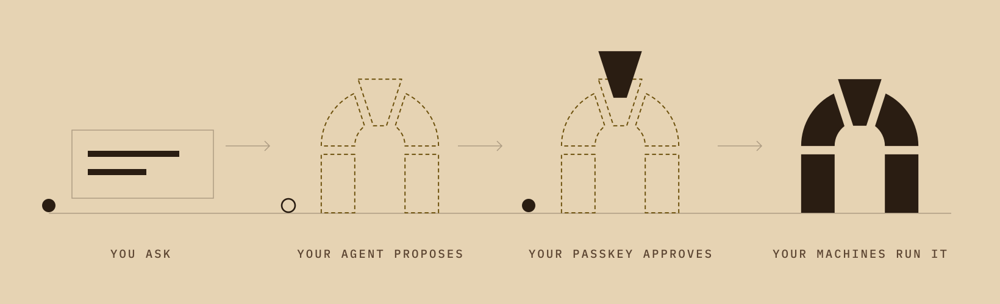

<p align="center">
  <picture>
    <source media="(prefers-color-scheme: dark)" srcset="assets/readme/arca-logo-night.svg">
    
  </picture>
</p>

<h1 align="center">Be your own cloud.</h1>

<p align="center">
  Infrastructure for AI agents. Yours, end to end.
</p>

<p align="center">
  Arca turns the machines you already own into your own cloud.
</p>

<div align="center">

[**Quickstart**](docs/QUICKSTART.md) · [**Guide**](docs/OPERATING.md)

</div>

## Works today, and not yet

Arca is an alpha. Read this before you install.

| Works today | Not yet |
|---|---|
| The installer below sets up a node that only looks. An assistant with its token reads your projects, instances, host readings and alerts, and changes nothing. | The installer does not turn on changes, and it sets up no approval page. Both are done by hand today: [what to set, and where the guide says how](docs/QUICKSTART.md#next-a-node-that-changes-things). A one-step way is being built. |
| On a node set up by hand to change things, these run from the templates Arca ships: Postgres, NATS, Omni, Automagik, a Cloudflare tunnel, a workspace virtual machine and GitHub runner pools. A GitLab runner pool ships too: it is new and has not yet run against a real GitLab. An assistant proposes, and you approve with your passkey on a page the node serves. | Arca cannot run any app or container image you name: a service comes from a template, or Arca takes over one that already runs on the machine. |
| The node is an MCP server over HTTP. An assistant with a shell on the same machine reaches it with `arca call`. | The installer opens no network address. An assistant that takes an MCP server URL needs one you add to the config by hand: [step 4 of the quickstart](docs/QUICKSTART.md#by-hand). |
| One Linux machine (x86_64) with Incus. | There is no installer for a Mac, and the installer has not been run on a machine that never had Arca or Incus. |

## Get Arca

| | |
|---|---|
| **Linux** | [Download](https://github.com/automagik-si/arca/releases) · [five-minute quickstart](docs/QUICKSTART.md) |
| **Your agent** | Paste this to it: *"Install Automagik Arca on this Linux machine from github.com/automagik-si/arca, following docs/QUICKSTART.md. Show me each command first."* |

On a Linux machine with Incus ([what this does and does not do](docs/QUICKSTART.md#install-with-one-command)):

```sh
curl -fsSL https://get.automagik.si/arca | sh
```

This gives you a node that only looks: it reads your machines and changes nothing, and it has no approval page yet. Letting it change things is [set up by hand today](docs/QUICKSTART.md#next-a-node-that-changes-things); a one-step way is being built.

## How it works

<p align="center">
  <picture>
    <source media="(prefers-color-scheme: dark)" srcset="assets/readme/how-it-works-night.svg">
    
  </picture>
</p>

**Say it.** Tell your agent what you need: a database, an app, another machine in the group.<br>
**Approve it.** Set up the way the quickstart shows, an assistant can only look and propose. You approve with your passkey.<br>
**Done.** Arca runs it on your machines and keeps an append-only journal of the changes it applies.

## What it runs

Your agents and everything around them: **Postgres** · **NATS** · **Omni** · **Automagik** · **tunnels** · **workspaces** · **build runners**.

## Yours

Open source, Apache-2.0. Self-hosted. Arca itself needs no outside service to work.

<p align="center">
  <a href="docs/QUICKSTART.md">Quickstart</a> ·
  <a href="docs/OPERATING.md">Guide</a> ·
  <a href="docs/ARCHITECTURE.md">Architecture</a> ·
  <a href="CHANGELOG.md">Changelog</a> ·
  <a href="https://github.com/automagik-si/arca/releases">Releases</a>
</p>

<p align="center">
  <a href="https://weunfold.ai/"><picture><source media="(prefers-color-scheme: dark)" srcset="assets/open-intelligence/open-intelligence-badge-ivory.svg"></picture></a>
</p>
